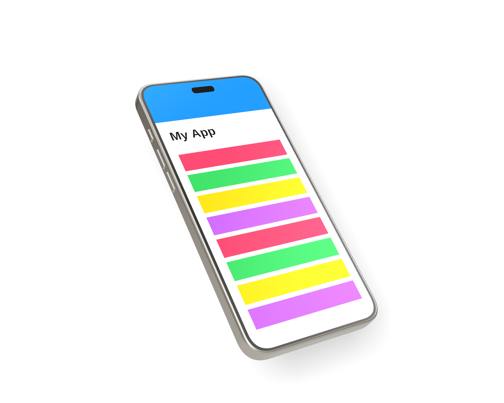

# iPhone Mockup Generator



A local web app that renders a 3D iPhone (iPhone 15 Pro proportions) with your own screenshot on the display, lets you rotate it on the X/Y/Z axes, and exports the view as a PNG.

## Run it

Requires Node.js 18+.

```bash
npm install
npm run dev
```

Then open http://localhost:5173.

Live version: https://matjazkrmelj.github.io/iPhone-mockups/ (deployed by GitHub Actions on every push to `main`).

To build a static version: `npm run build` (output in `dist/`, serve with `npm run preview`).

## Features

- **Screenshot**: upload, drag & drop, or paste (Cmd/Ctrl+V) an image. "Cover" crops to the screen's aspect ratio; "Stretch" fills it exactly. Native iPhone screenshots (e.g. 1179 × 2556) fit perfectly. The Dynamic Island overlay can be toggled off.
- **Rotation**: drag the phone to turn it (Shift+drag rolls on Z, scroll wheel zooms), or use the X, Y and Z sliders (−180° to 180°). Double-click a slider, or click its value, to reset that axis. Presets for common angles.
- **Model**: choose the detailed *iPhone 14 Pro* (default; Space Black, Silver, Gold, Deep Purple) or the *Simple* procedural iPhone 15 Pro-style model (Natural / Black / White / Blue Titanium).
- **Scene**: zoom, background colour, transparent background.
- **Surface**: choose whether the phone is *Standing* on a floor or *Lying flat* on a table. The shadow is cast onto that surface, which always touches the phone's lowest point whatever its rotation.
- **Light**: key light direction and elevation (measured from the surface), strength, environment reflections, screen glare and exposure.
- **Shadow**: on/off, opacity, softness, and the gap between the phone and the surface.
- **Camera height**: look down at the scene (defaults to 20° when standing, 0° when lying flat).
- **Export**: PNG at 1×–4× the viewport size. With "Transparent background" on, the PNG has an alpha channel.

## Credits

The detailed model is ["iPhone 14 Pro"](https://sketchfab.com/3d-models/iphone-14-pro-5cb0778041a34f09b409a38c687bb1d4) by [mister dude](https://sketchfab.com/misterdude), licensed under [CC BY 4.0](https://creativecommons.org/licenses/by/4.0/). The screen, Dynamic Island overlay and colour tints are added by this app.

## Files

- `src/phone.js` builds the iPhone model procedurally with Three.js (no external model files): rounded titanium frame, raised cover glass, antenna bands, USB-C port, speaker grilles, side buttons and a detailed camera plateau.
- `src/glbPhone.js` loads the detailed model (`public/models/iphone-14-pro.glb`) and overlays the screenshot on its screen.
- `src/main.js` handles the scene, sidebar controls, and export.
